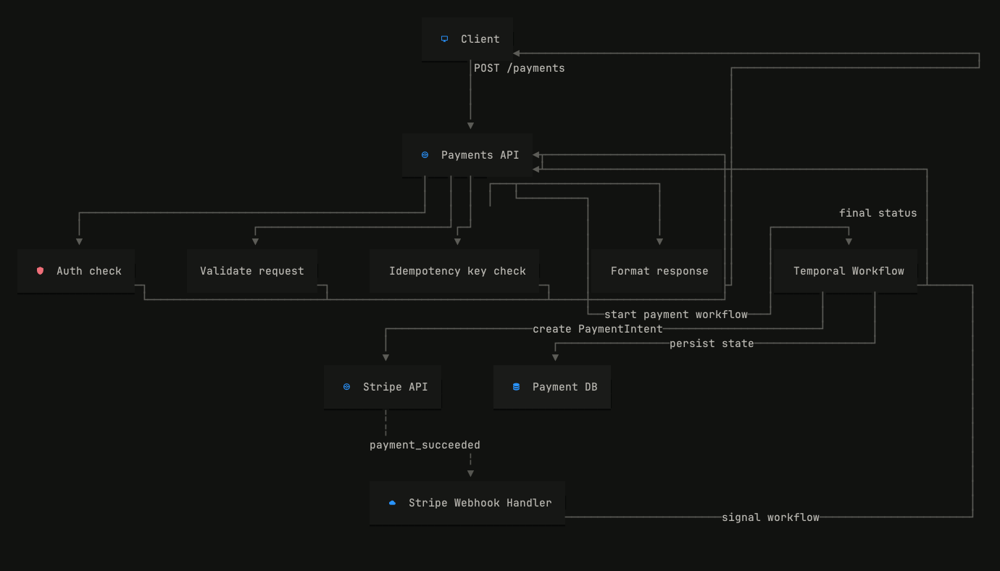

# Diaview

**A terminal-native diagram renderer and agent-native visual workspace for architecture workflows.**

Diaview parses Mermaid flowcharts into an internal graph IR, lays them out with a pure-Rust topological engine, and renders 24-bit ANSI diagrams directly in your terminal, scrollback, or persistent interactive TUI.



*Rendered from [`fixtures/temporal_payment_feedback_regression.mmd`](fixtures/temporal_payment_feedback_regression.mmd) showing orthogonal routing, stencil icons, and perimeter return loops.*

---

## Why Diaview

- **Terminal-first, not a degraded web view:** Built directly on Ratatui and Crossterm with truecolor 24-bit ANSI fills, borderless cards, and subtle character shadows. No Kitty graphics protocol hacks or raster browser embeds required.
- **Agent-native feedback loop:** Designed as a visual REPL for human and AI co-design. Point at nodes, dispatch instructions via Herdr, and watch the diagram update live in an adjacent pane.
- **Pure Rust layout engine:** Owns the entire pipeline from Mermaid parsing to coordinate ranking and orthogonal route planning. Zero external layout dependencies (no Graphviz, dagre, or node-canvas).
- **Scrollback-friendly:** Fullscreen interactive mode for deep inspection, plus `--inline` output that prints directly into terminal scrollback, tmux panes, and AI agent tool responses.

---

## Quick start

Build and run Diaview from source using Cargo:

### 1. Interactive fullscreen view

Launch the persistent TUI viewer:

```bash
cargo run -- fixtures/temporal_payment_feedback_regression.mmd
```

### 2. Inline terminal output

Print ANSI-rendered diagrams directly into your terminal scrollback without entering alternate screen or raw mode:

```bash
cargo run -- --inline fixtures/temporal_payment_feedback_regression.mmd
```

### 3. Pipe from standard input

Stream Mermaid directly through Diaview in shell pipelines:

```bash
cat fixtures/simple.mmd | cargo run -- --inline
```

---

## Controls & Herdr agent loop

Diaview provides keyboard-driven navigation and an integrated agent feedback loop.

### Standalone fullscreen navigation

| Key | Action |
| --- | --- |
| `Tab` | Select next node following visual diagram flow |
| `Shift+Tab` / `BackTab` | Select previous node |
| `q` / `Esc` | Quit Diaview |

The bottom status bar shows the currently selected node identifier, label, and available key hints. Selected cards are highlighted with a prominent blue fill. Routing dummy nodes are skipped automatically during navigation.

### Herdr sidecar: Visual REPL for AI agents

Diaview integrates natively with [Herdr](docs/interaction.md) to enable an interactive co-design loop:

```bash
diaview --herdr diagram.mmd
```

1. **Targeted prompts:** Select any node and press `i` or `Enter` to open the action bar. Type a natural language instruction (e.g., *"Insert a Redis cache before this service"*).
2. **Agent dispatch:** Pressing `Enter` dispatches a context-rich instruction via `herdr agent prompt` (including the selected node ID and label, diagram path, and user request).
3. **Live file watching:** Diaview enters a waiting state and monitors the Mermaid file. When the AI agent writes an updated diagram, Diaview automatically re-parses, re-lays out, and re-renders the diagram on the fly while preserving node selection.
4. **Resilient error handling:** If the agent emits invalid intermediate Mermaid, Diaview preserves the last valid diagram on screen and reports the error in the status bar until corrected.

---

## Supported Mermaid scope

Diaview supports a focused, robust subset of Mermaid flowcharts optimized for system architecture:

- **Directions:** `flowchart TD`, `flowchart LR`, `graph TD`, `graph TB` (normalized to top-down).
- **Node shapes:**
  - Rectangles: `A[API Gateway]`
  - Rounded rectangles: `B(Service)`
  - Decision diamonds: `C{WAF Allows?}`
  - Circular nodes: `D((Client))`
  - Database cylinders: `E[(Postgres DB)]`
- **Edges & connectors:**
  - Solid arrows: `-->`
  - Unlabeled solid links: `---`
  - Dashed arrows: `-.->`
  - Dashed links: `-.-`
  - Thick arrows: `==>`
  - Edge labels: `-->|text|` and `-- text -->`
- **Subgraphs:** `subgraph Title ... end` rendered as background cluster boundaries.
- **Comments & formatting:** Single-line comments starting with `%%` and semicolon-separated statements.

For deeper technical documentation, see:
- [docs/parser.md](docs/parser.md) — Mermaid grammar, normalization, and parsing rules.
- [docs/layout.md](docs/layout.md) — Layering, barycenter crossing reduction, port assignment, and lane reservations.
- [docs/rendering.md](docs/rendering.md) — Character grid rasterization, Ratatui canvas widgets, and ANSI truecolor styling.
- [docs/interaction.md](docs/interaction.md) — AppState, persistent event loops, and Herdr sidecar protocol.
- [docs/architecture.md](docs/architecture.md) — End-to-end component dataflow and module boundaries.
- [docs/roadmap.md](docs/roadmap.md) — Long-term milestones, sequence diagrams, and expanded Visual REPL capabilities.

---

## Pipeline architecture

```text
Mermaid Source
      │
      ▼
Parser (src/parser/mermaid.rs)
      │
      ▼
Graph IR (src/model.rs)
      │
      ▼
Layout Engine (src/layout/simple.rs)
├── Topological layering & barycenter ordering
├── Port assignment (top/bottom/side)
├── Orthogonal lane reservation & trunk bundling
└── Group cluster bounding
      │
      ▼
Ratatui Canvas Renderer (src/renderer/canvas.rs)
      ├── Fullscreen TUI (raw mode, selection loop, status bar)
      ├── Inline ANSI output (direct to scrollback/stdout)
      └── Herdr Sidecar (action bar, IPC dispatch, live file watcher)
```

---

## Font requirement

Diaview requires **Nerd Fonts v3** glyph support to render engineering stencil icons (database, bucket, queue, router, worker, shield, pulse, etc.).

Ensure your terminal emulator uses a patched Nerd Font (such as *JetBrainsMono Nerd Font*), or install `Symbols Nerd Font Mono` as a fallback font.

On macOS using Homebrew:

```bash
brew install --cask font-symbols-only-nerd-font
```

---

## Development

```bash
# Validate formatting, types, and non-interactive tests
cargo fmt --check
cargo check
cargo test

# Inspect inline rendering on test fixtures
cargo run -- --inline fixtures/temporal_payment_feedback_regression.mmd
```

Refer to [docs/development.md](docs/development.md) and [docs/testing.md](docs/testing.md) for local workflows and non-interactive testing practices.

---

## License

Diaview is dual-licensed under either:

- **MIT License** ([LICENSE-MIT](LICENSE-MIT))
- **Apache License, Version 2.0** ([LICENSE-APACHE](LICENSE-APACHE))

at your option.
